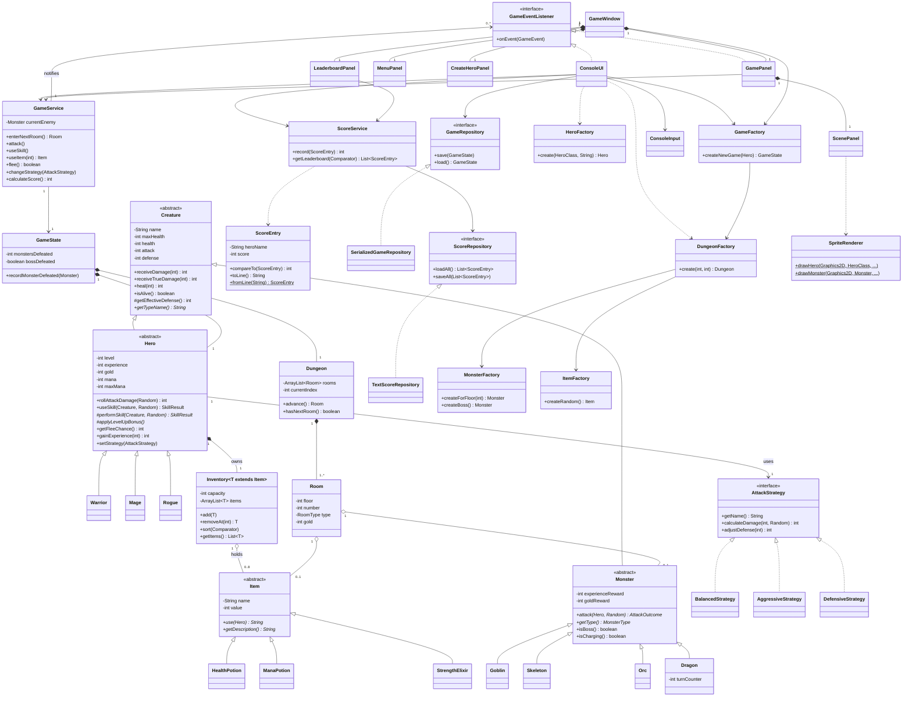

# UML Class Diagram

## Pattern mapping

| Pattern | Role | Classes |
|---|---|---|
| Strategy | Strategy | `AttackStrategy` |
| | Concrete strategies | `BalancedStrategy`, `AggressiveStrategy`, `DefensiveStrategy` |
| | Context | `Hero` (`rollAttackDamage`, `getEffectiveDefense`) |
| Factory | Creators | `HeroFactory`, `MonsterFactory`, `ItemFactory`, `DungeonFactory` |
| | Products | `Hero`, `Monster`, `Item`, `Dungeon` |
| Observer | Subject | `GameService` |
| | Observer | `GameEventListener`, implemented by `ConsoleUI` and `GamePanel` |
| Factory | Run creation | `GameFactory` used by both interfaces |
